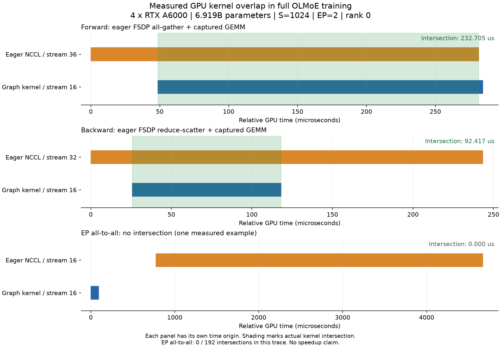

# FSDP v2 partial CUDA Graph: overlap validation

This is a focused record for [PR #9112](https://github.com/NVIDIA/Megatron-LM/pull/9112) and [RFC #9113](https://github.com/NVIDIA/Megatron-LM/issues/9113). It records the earlier full-model four-GPU validation and a separate current-runtime two-A6000 proxy performance comparison.

## Workload and correctness

The complete 6,919,161,856-parameter [OLMoE-1B-7B-0924](https://huggingface.co/allenai/OLMoE-1B-7B-0924/tree/6d84c48581ece794365f2b8e9cfb043c68ade9c5) architecture was randomly initialized and trained on WikiText-103. `olmoe_spec.py` is the validation-only model spec adapter; training used the repository's `pretrain_hybrid.py`. Four 48 GB RTX A6000 GPUs, BF16, FSDP ZeRO-3, EP=2, gradient accumulation 2, sequence length 1024 and dropout 0.1 were used. PyTorch was 2.11.0+cu130 and Transformer Engine 2.20.2. Command arguments are in the four `command.json` files; local paths have been replaced by placeholders. Input hashes are in `input-provenance.json`.

Eager and partial capture each completed 12 steps with evaluation. All 72 selected serialized training and validation scalar events matched exactly (`metrics.json`). Both modes then resumed the same eager step-12 checkpoint to step 18; all 38 selected events matched (`resume-metrics.json`). Partial mode captured again after warmup and replayed at steps 16–18. The full-model run did not compare every gradient, weight, or Adam tensor. Iteration lines and process exit status are retained as extracts, not complete logs.

The first eager restart failed because the changed training endpoint conflicted with the saved weight-decay schedule. Retrying with the existing `--use-checkpoint-opt-param-scheduler` succeeded. The first partial restart reached a 600-second collective timeout before graph capture; rank progress was consistent with uneven checkpoint reads. Retrying with the existing `--distributed-timeout-minutes 30` succeeded. These retries did not modify runtime code. The approximately 77 GiB checkpoint was deleted after inspection as requested; no checkpoint or training data is published here.

The run used runtime commit `cf473f207e4c09e3a108457969352b92b7efb86c`; `final-source-verification.json` records the matching tested source hashes. Follow-up changes to the PR add documentation and regression tests only. The two-GPU RTX PRO 6000 partial suite passed 78 cases per rank. The four new shared/separate communication-stream policy cases passed per rank on both two RTX PRO 6000 and two RTX A6000 GPUs. These focused tests compare loss, gradients, main weights and Adam moments with zero tolerance. Earlier four-GPU and full-model tensor-comparison evidence is [separately archived](https://github.com/WEIXILIN0307/Megatron-LM/tree/24b0becb108c7a34790288d1c77cee6d18c529b8/mfsdp-v2-partial-cg-20261108).

## Trace and overlap

`rank-0-filtered.json.gz` contains one profiled optimizer iteration on rank 0. The original trace SHA-256 is `92bfba8282886d912387644a6adef9ffef74d826afcc2c8e763d0781f960a678`. Filtering retains only GPU kernel events, `cudaGraphLaunch` runtime events, and `Graphed` / `GraphedBackward` CPU events. It retains only event name, category, phase, timestamps, duration, process/thread IDs and correlation, device, context, stream and collective/process-group arguments. Other metadata, paths and environment values are removed. File hashes for the published artifact are in `SHA256SUMS`.

Run `python analyze_trace.py rank-0-filtered.json.gz --output reproduced.json`. It attributes GPU kernels to graph launches by correlation, identifies forward/backward from containing CPU calls, and counts communication kernels whose GPU execution interval intersects graph-compute kernels on the same device and a different stream. This reproduces 128 launches (64 forward, 64 backward):

| Collective | Overlapping / total kernels | Graph phase |
| --- | ---: | --- |
| Ordinary DP all-gather | 61 / 132 | 32 forward, 29 backward |
| Expert-DP all-gather | 32 / 64 | forward |
| Ordinary DP reduce-scatter | 32 / 66 | backward |
| Expert-DP reduce-scatter | 32 / 32 | backward |
| Expert-model-parallel all-to-all | 0 / 192 | — |

Expert-DP collectives are FSDP communication; expert-model-parallel all-to-all is dynamic token dispatch. This observation is limited to one rank and iteration. It does not establish overlap for every operation, performance gains, convergence, or support for the separate MoE expert-overlap schedule. Upstream CI and maintainer acceptance remain separate.

## Measured overlap

Each panel has a separate time origin. Green shading is an actual GPU kernel time intersection. Stream IDs and selected intervals are retained in `overlap-observation.json`. Run `python plot_observation.py` with Matplotlib to regenerate the figure from the published filtered trace. This figure describes the earlier full-model four-GPU trace, not the two-GPU proxy timing run.

## Current-runtime performance

See [the separate two-A6000 proxy benchmark](performance/README.md) for all repeats, capture cost, memory, timing method and limits. The proxy result must not be represented as a complete OLMoE speedup.
