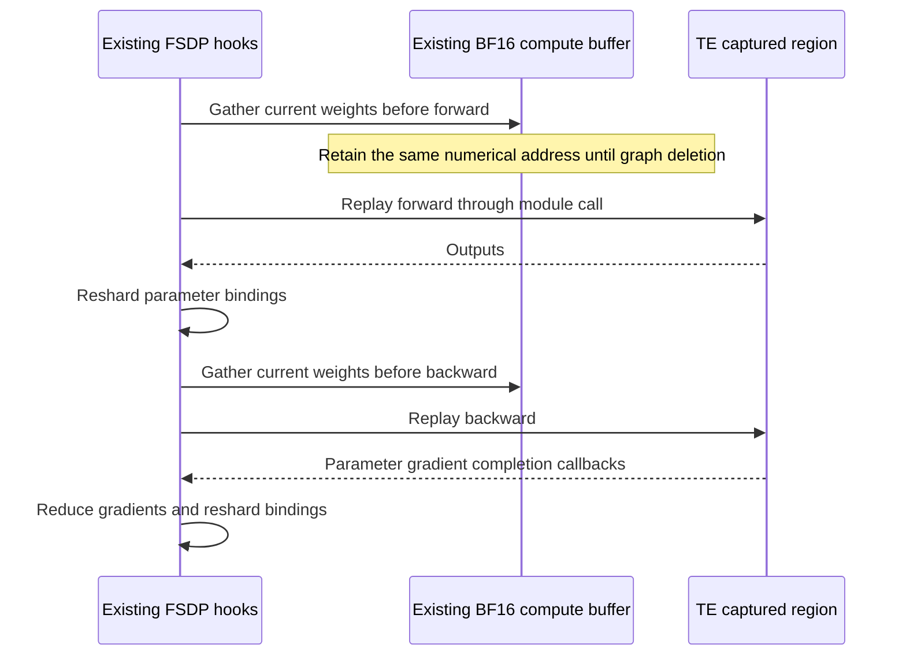

# Megatron FSDP v2 partial CUDA graph design

The integration captures existing fixed-shape attention, dense MLP, and MoE
router/preprocess regions with Transformer Engine and composes them with the
existing dynamic expert dispatch and MFSDP v2 runtimes. It establishes correctness
for a restricted configuration and documents the resident compute-weight memory
cost.

## Reproduced failures

Four independent contracts matter:

1. **Module hooks.** TE rejects callables with module execution hooks at capture
   time. MFSDP v2 needs these hooks for gather, reshard, prefetch ordering, and
   gradient reduction. GraphableMegatronModule's direct replay dispatch also
   bypasses `nn.Module.__call__`, so simply removing capture-time hooks loses the
   replay lifecycle.
2. **Storage addresses.** V2 normally releases gathered compute storage after
   use. CUDA graphs retain numerical addresses, not PyTorch Storage identities.
   Moreover, CUDA `Storage.resize_` may reallocate even when its size is unchanged.
   Retaining storage without skipping redundant resizes produces a model that
   runs but diverges immediately after capture.
3. **Evaluation ordering.** Normal eager train/eval/train fails when evaluation
   consumes a training execution-order event without a corresponding backward.
4. **Checkpoint layout.** Normal eager SwiGLU checkpointing enters v1 projection
   conversion, which assumes v1 wrapper paths and slice metadata. V2 exposes
   native packed DTensor views instead.

The evaluation and checkpoint failures also occur without graphs and should be
reviewed independently from the graph integration.

## Existing contracts and implementation

During capture, an FSDP unit must be idle. A scoped context gathers its existing
BF16 buffers, exposes its original full Parameters, and suspends only its own
module execution hooks. Parameter gradient-completion callbacks are suppressed
while TE performs real warmup backward passes. This avoids modifying the
execution trace, gradient countdown, or reduction state during capture. The
context restores hooks and sharded bindings on success or failure. The helper
owns retained storage cleanup, so a failed capture resets returned graphs
before releasing that storage.

Failure cleanup also covers input preparation and binding the graphs returned by
TE. Returned graphs are reset before retained compute storage is released. A
failed attempt clears its capture flags, constants and temporary training state
and restores RNG contents through the existing graph-safe RNG helpers. TE's
temporary module-class call wrappers and capture flag are also restored when
its call raises. This matters for dropout: TE restores RNG after successful capture, but a failed
warmup can otherwise consume the next training step's random numbers. Cleanup
supports retrying recoverable Python errors, not continuing after fatal CUDA or
NCCL failures.

During replay, the FSDP mixin dispatches the graph through `nn.Module.__call__`.
The existing forward-pre hook gathers current weights and waits for completion;
the existing backward-pre hook gathers weights before graph backward. Existing
parameter-completion hooks consume gradients and perform their usual reductions.
The implementation reuses the FSDP buffer allocator and TE's graph/autograd
machinery. It does not introduce a separate parameter or gradient store.

The lifecycle of each captured FSDP unit is:

Dynamic dispatch and routed-expert compute remain between the captured regions
in the existing MoE execution path. FSDP communication stays outside the graphs.

Captured FSDP units retain gathered storage, and gather only reallocates storage
that has been released. This preserves numerical addresses across forward,
backward, evaluation, and optimizer updates. Graph deletion resets the graphs
before releasing their compute-weight buffers. Routed experts stay outside the
captured regions and retain their normal FSDP lifecycle. Router capture reuses
the existing partial MoE implementation, including shared experts when present;
preprocess capture must be paired with router capture.

In GPTModel the ownership unit is a complete TransformerLayer, so retention also
covers its eager dense MLP and shared-expert buffers. HybridModel already splits
attention and MLP/MoE into separate layers; reusing these existing boundaries
retains only selected units without changing FSDP ownership. Retention costs a
full BF16 copy of each captured unit's owned weights per rank, alongside the configured
shards of main weights, gradients, and optimizer state. It is an explicit initial
tradeoff, not a claim of memory-optimal ZeRO3 partial capture. All-gathers still
run outside the graphs; partial capture alone does not remove their launch cost.

Pure evaluation (`eval()` and gradients disabled) gathers on demand without
advancing the training trace. Training-mode `no_grad()` is preserved for
reentrant checkpoint semantics. V2 checkpoint preprocessing retains native
packed projections and uses the existing expert naming and uneven DTensor
handling on both save and load. Cross-version checkpoint conversion is separate.

## Acceptance checks

The current GPU acceptance environment uses PyTorch 2.11.0+cu130 and Transformer
Engine 2.20.2 on RTX PRO 6000 GPUs. These results do not establish compatibility
with every dependency version or the full NVIDIA CI hardware matrix.

`tests/unit_tests/distributed/mfsdp_v2/test_mcore_partial_cuda_graph.py` uses a
real two-layer GPTModel and an equivalent four-layer HybridModel pattern
(`*-*E`), a dense block followed by MoE, EP2, shared experts, SwiGLU, and a
next-token language-model cross-entropy objective and nonzero MoE auxiliary loss.
It compares ordinary attention and MLA across the three sharding strategies and
five scope combinations (attention, dense MLP, router, attention/MLP/router, and
attention/MLP/router/preprocess), for 60 configurations. GPT uses the existing
decoder block spec to honor its mixed dense/MoE layer pattern. Two microbatches
accumulate into every update. Each test owns and destroys its MoE metrics tracker
because GPT and Hybrid models have different layer counts. Checks cover:

- identical initial seeds and changing inputs across training steps;
- eager evaluation between training forwards;
- unchanged main weights during capture;
- loss, every gradient shard, every updated main-weight shard, and both Adam
  moment tensors against eager with zero tolerance;
- actual `cudaGraphLaunch` events during replay;
- stable gathered-buffer pointers;
- unsupported-configuration rejection before capture starts;
- restoration after TE rejects a user hook, followed by a successful retry;
- graph deletion, released compute buffers, and subsequent eager training.

Fourteen additional focused cases cover GPT and Hybrid with nonzero attention
dropout, hidden dropout, and both; failures during input preparation, a real TE
warmup forward, and returned-graph binding; and three capture/delete cycles with
eager updates between them. They compare real LM losses, gradients, main weights
and Adam moments to eager with zero tolerance, inspect RNG state contents, and
check stable addresses and allocated-memory release. Recapture uses a new
`TECudaGraphHelper` for the same model and optimizer, following the existing
single-use helper contract.

The existing MoE training/clipping test also covers repeated evaluation, and
the existing EP checkpoint roundtrip test goes through production preprocessing
with SwiGLU instead of bypassing it.

End-to-end validation uses the stock `pretrain_gpt.py` and `pretrain_hybrid.py`
entry points with real text, evaluation, normal RNG/Adam checkpoint loading and
graph recapture after restart. Full-size validation uses
the complete OLMoE-1B-7B-0924 architecture: 6,919,161,856 parameters, 16
attention/MoE blocks, hidden size 2048, 64 experts and top-8 routing. It starts
from random initialization and uses the public tokenizer and real WikiText-103
train/validation data. The model-spec adapter applies the existing TE RMSNorm
to the full-width Q/K vectors through existing module-spec extension points.
This checks integration with the complete architecture, rather than pretrained
weight conversion or equivalence to another framework's training recipe.

Compare all saved model and Adam tensors, actual deserialized DCP metadata,
RNG payloads, and training/validation scalar events against eager. Inspect saved
optimizer step values and profile actual forward/backward graph launches.
Stochastic validation sets attention and hidden dropout to 0.1 and compares
matched restarts from the same checkpoint. A short run establishes integration
correctness, not full pretraining convergence. Historical long-run and timing
results must identify the source revision they measured; profiler timings are
not performance benchmarks.

For native DCP restart comparisons, both runs use the existing TE RNG tracker
and the same saved RNG schema. The integration does not convert ordinary
Tensor RNG state into graph-safe Generator state. When optimizer restoration
leaves unused CUDA allocator cache under memory pressure, the existing
`--empty-unused-memory-level 2` training policy can release that cache; apply
the same policy to both resumed modes before comparing them.

This work is limited to the supported MFSDP v2 partial-capture configuration and
its end-to-end MoE composition validation. Other precision, recomputation,
parallelism and communication-overlap features remain outside this integration;
its acceptance checks do not imply support for them.
