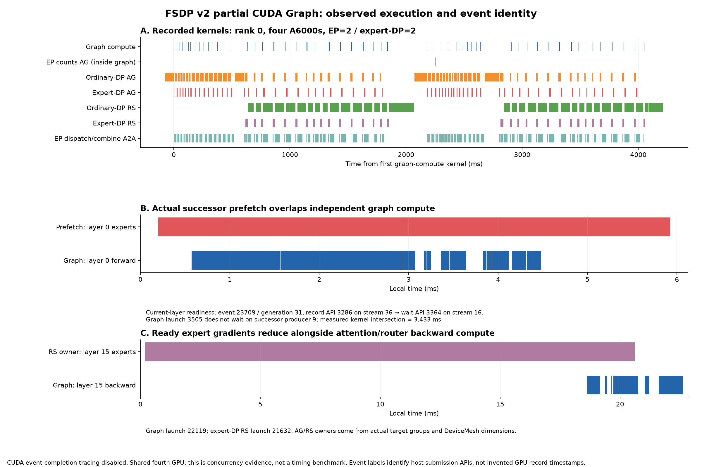

# FSDP v2 partial CUDA Graph: event attribution and bounded performance evidence

This bundle qualifies the existing implementation in NVIDIA/Megatron-LM#9112. The tested composition is `a8a842466016426769ca479eac22a6354e4668a4`, including the independent evaluation/checkpoint prerequisites. No Megatron production code or EP scheduler was changed to obtain these results. Exact software versions and input hashes are in `environment.json` and `input-manifest.json`.

## Model and measurement

Stock `pretrain_gpt.py` trains a randomly initialized **2.09B GPT MoE proxy**, not full OLMoE, on real WikiText-103: 16 layers, hidden 2048, 16 experts, top-8, BF16, ZeRO-3, sequence 1024, microbatch 1, gradient accumulation 2, dropout 0.1, seed 1234. TP=PP=CP=expert-TP=1. Capture selects `attn moe_router moe_preprocess`. `model-args.json` supplies the common numerical flags; each run's `command.json` records its actual topology, steps, and flags. The LR schedule remains fixed at 1000 steps in every run.

Timing uses idle RTX A6000 devices 0/1 for EP2/expert-DP1 and 0/1/2 for EP1/expert-DP3. These connections are PCIe (`PIX`), not NVLink; full topology and selected-device telemetry accompany each run. Other GPUs remain shared. No profiler or tensor hashing runs during timing. Each process completes 45 optimizer steps; a synchronized window measures steps 16–45, with no additional per-step measurement synchronization. The reported run value is the slowest rank's window divided by 30. Means below use three separate processes per mode, with eager/graph order reversed in the middle block. These are finite repeat measurements on this host, not confidence intervals or a universal speedup guarantee.

| Topology | Eager, ms/step (three runs) | Graph, ms/step (three runs) | Mean comparison |
|---|---|---|---|
| 2 GPUs, EP2 / expert-DP1, global batch 4 | 1181.39, 1176.70, 1178.21 | 1024.52, 1025.65, 1022.76 | 1178.77 → 1024.31 ms; **13.10% less step time / 15.08% higher throughput** |
| 3 GPUs, EP1 / expert-DP3, global batch 6 | 2576.49, 2586.07, 2591.49 | 2597.37, 2598.16, 2599.43 | 2584.68 → 2598.32 ms; **graph 0.53% slower** |

All 45 per-rank losses match exactly across eager/graph repeats within each topology; no step is skipped. Do not compare the two topologies as a scaling experiment: their sharding, global batch and collective groups differ.

Separate two-rank EP2 runs hash all logical local-shard tensor bytes at steps 4 and 12, covering model parameters, gradients before optimizer, main weights and Adam state after optimizer. All metadata and digests match except one step-12 rank-1 expert gradient: its **4756 signed-zero elements** differ as `-0.0` versus `+0.0`. A focused rerun reproduces every original state digest, and direct full-tensor comparison establishes numerical equality with maximum absolute difference **0**. Normalizing zero signs makes the gradient hashes identical; parameters/main weights/Adam already match byte for byte. An independent eager repeat reproduces all snapshots exactly. `state-comparison.json`, `focused-gradient-comparison.json` and two compressed focused tensors make this distinction reproducible; raw gradient byte identity is not claimed.

## End-to-end value of preserved concurrency

The measurement-only `graph-boundaries-v2` control adds event dependencies before/after each forward or backward graph replay. Compute first waits for FSDP AG/RS streams; those streams then wait for the submitted graph. It preserves the same model, buffers, capture scope and numerical/collective work. This is an intentionally stronger ordering, not a proposed production implementation.

On EP1/expert-DP3, qualified control runs take **2734.30, 2742.54 and 2724.27 ms/step**, mean **2733.70 ms**. Normal graph execution averages **2598.32 ms**, 135.38 ms/step or **4.95% less time than the serialized control**. All losses match exactly. The final control run spends at most 3.33 ms/step on added CPU event enqueue calls. A single 45-step placebo using the same number of joins on otherwise empty streams takes **2586.51 ms/step**, with at most 3.21 ms/step of enqueue calls. The placebo retains AG/RS intersections, while real-stream serialization eliminates them in all three rank traces.

The controls support a bounded, application-level scheduling benefit from leaving FSDP communication concurrent with graph compute. **135.38 ms is not a measurement of physical network time hidden**, nor proof that graph beats eager on this topology; the eager comparison above is slightly negative. The older broad serialization experiment is excluded because it also serialized eager compute. No qualified claim uses that control.

## Memory and capture cost

Peak values below are maximum per-rank PyTorch allocated/reserved memory during the same steady windows, taking the maximum over repeats. CUDA/NCCL allocations outside the PyTorch allocator are excluded. Each allocator budget is startup free memory minus 4 GiB.

| Topology | Eager allocated / reserved | Graph allocated / reserved | Graph helper setup, max-rank range |
|---|---|---|---|
| EP2 / expert-DP1 | 21.720 / 23.814 GiB | 20.495 / 25.391 GiB | 2.325–2.916 s |
| EP1 / expert-DP3 | 16.354 / 17.801 GiB | 15.124 / 19.402 GiB | 2.103–2.349 s |

Each graph rank retains **32.07421875 MiB × 16 units = 513.1875 MiB** of non-alias compute-weight storage. This is retained residency, not the peak-memory delta: activation reuse, graph pools and caching differ too. Graph setup includes helper synchronization/cleanup, not process startup. The previous PRO experiment's 17.360 GiB allocator budget still documents a capacity limit; these successful runs establish a matched comparison with sufficient headroom, not a fix for all OOMs.

## Exact event and EP2 attribution



The canonical EP2/expert-DP2 trace uses four A6000s, one optimizer step (step 6 of 8), with CUDA event-completion tracing **disabled**. GPU7 has another workload, so this trace establishes concurrency and ordering, not steady performance. A second completion-enabled recording confirms identity matching; its timings are not used as performance evidence.

Trace-only wrappers log actual AG target parameter group, FSDP unit/phase, readiness handle/generation, graph callable and replay stream, gradient packing/reduction and finish-sync scopes. DeviceMesh dimensions distinguish ordinary DP `[0,1,2,3]`, expert-DP `[0,2]` / `[1,3]`, and EP `[0,1]` / `[2,3]`. They do not infer ownership from the enclosing prefetch caller.

Every rank has **132 matched readiness producer/wait chains**, **64 graph launches linked to their own readiness waits**, **32 actual successor-prefetch/graph intersections**, and **298 native event pairs** around reduction packing/finish synchronization. Matching uses `(globalPid, contextId, eventId, eventSyncId)`; device ordinals differ between Nsight tables and are deliberately not equated. AG kernels are checked to be submitted on their producer stream before its readiness record. An execution-order successor can be the expert unit in the same TransformerLayer; `i+1` does not mean the next numbered layer, and AG-to-graph relationships are not generally one-to-one.

One concrete witness: graph launch **3505**, layer 0 forward, overlaps AG **3390** targeting layer 0 experts by **3.433475 ms** of kernel intervals. Its own readiness is event **23709**, generation **31**, record API **3286** on stream **36**, wait API **3364** on stream **16**. The successor producer **9** is distinct from its current readiness dependency.

| EP2/expert-DP2 rank | Expert-DP AG / graph compute | Expert-DP RS / graph compute |
|---|---:|---:|
| 0 | 65.734 ms | 137.296 ms |
| 1 | 54.214 ms | 84.722 ms |
| 2 | 112.467 ms | 17.440 ms |
| 3 | 117.959 ms | 139.557 ms |

Ordinary-DP AG/RS and EP token dispatch/combine A2A have **zero** graph-compute intersection in this trace. All four ranks' eight losses match the four-rank eager run exactly. Trace-specific kernel intersections do not measure exposed critical-path time or network progress. Nsight synchronization `start/end` fields describe host API timing, not device wait stalls.

EP2 also has **32 graph-internal NCCL count-gather kernel occurrences/rank**. A separate capture-provenance run records 16 routing-count gathers, each with 16 int64 elements on the EP group, replayed twice under GA2. These arise from `MoEAlltoAllTokenDispatcher.preprocess()`; **zero FSDP parameter gathers occur during TE capture**. Count-gather metadata, FSDP weight AG and EP token A2A are reported separately.

## TE warmup failure and retry

Stock TE 2.20.2 reproducibly retains a temporary discovery hook when a module raises during warmup. The independent TE candidate `0eb9c38ba05932a6db5bafb6fbc4fa50661fee8e` adds `finally` cleanup for owned hooks and saved RNG/class-call/FP8/capture state. It adds one standalone failure/retry regression; no MCore or EP scheduler workaround is introduced.

Qualification uses isolated Python overlays; shared installed TE and native binaries remain unchanged. An equivalent release overlay passes two focused tests. Patched upstream-main Python code with installed 2.20.2 native binaries passes three focused TE tests. Downstream GPT and Hybrid MoE failures injected after a real QKV forward both retry successfully on two GPUs, matching eager training state. `te-validation/` records stock failure, passes and existing warnings. The final TE commit adds documentation only after the tested code. A current-main native rebuild and full upstream CI have not run. Fatal CUDA/NCCL failures and arbitrary rollback remain outside the guarantee.

## Reproduction

Offline attribution needs Python's standard library only; plotting additionally needs matplotlib. Compressed SQLite exports retain exact kernel/runtime/event/synchronization rows and required NVTX labels, preserving NVTX row order. They omit system/environment tables, unrelated strings and NVTX payloads. `offline-reproduction.json` verifies that every analysis field matches the original export after removing the unused `parameter_allreduce` metadata key; DeviceMesh dimensions remain authoritative. Published console logs have line-end whitespace trimmed; selected-GPU telemetry omits process IDs and other devices.

```bash
python -S scripts/analyze_trace.py runs/trace-ep2-edp2-natural
python -S scripts/analyze_trace.py runs/trace-ep1-edp3-natural
python -S scripts/analyze_trace.py runs/trace-ep1-edp3-serialized
python -S scripts/analyze_trace.py runs/trace-ep1-edp3-empty-stream
python scripts/plot_timeline.py .
python -S scripts/summarize.py .
python -S scripts/compare_states.py .
python scripts/compare_gradient.py .
```

Run the analyzer for `trace-ep2-edp2-events` too before recomputing the full summary. `scripts/launch.py` and each `command.json` preserve the actual bounded training invocation and mount paths. Re-running training requires the recorded composition, matching dependencies, the tokenizer/indexed-data hashes and equivalent container mounts; adjust host paths/device UUIDs for another machine. The TE test is `tests/pytorch/test_cuda_graphs.py::test_warmup_forward_failure_cleanup_and_retry` in the independent TE source; the downstream supplement is `scripts/test_warmup_retry.py` under a two-rank torchrun/pytest invocation with the candidate Python overlay first on `PYTHONPATH`.

Full OLMoE, long-run convergence, generalized scaling and EP dispatch/combine overlap are not qualified by these experiments. The earlier focused MCore correctness suite remains the broader support-matrix evidence; these runs close the specific event, capacity, timing and warmup-dependency gaps.
