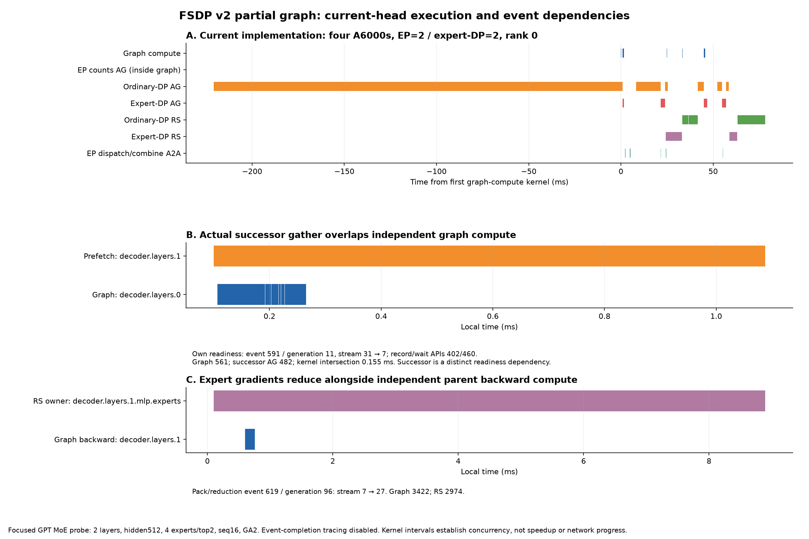

# FSDP v2 partial CUDA Graph review: 2026-11-15

This bundle records the fresh review of [PR #9112](https://github.com/NVIDIA/Megatron-LM/pull/9112) and [RFC #9113](https://github.com/NVIDIA/Megatron-LM/issues/9113). Current correctness/concurrency evidence and historical performance evidence have different sources. The current probe does not establish a speedup.

## Source and review findings

| Source | Commit |
|---|---|
| Reviewed/published core | [`e497dd0a2247e13bc9ed5c974a0bb286f4f599a4`](https://github.com/WEIXILIN0307/Megatron-LM/commit/e497dd0a2247e13bc9ed5c974a0bb286f4f599a4) |
| Upstream base | `c71687a40a302ca51917f85f963afee73a8fb8ce` |
| Core plus unchanged #9372/#9374 patches | [`e593b745422f60b235ca496d1d3d23aadfd9e55b`](https://github.com/WEIXILIN0307/Megatron-LM/commit/e593b745422f60b235ca496d1d3d23aadfd9e55b) |
| Pre-hardening PR baseline | `636b92dd4f863f1d8c922b8245ed46f0c524610e` |

The review read the latest Issue/PR bodies, all issue comments, reviews and inline comments, and the complete core diff against the listed base. `snapshots/` preserves those inputs. No human PR reviews had been submitted. The central maintainer request is [non-captured FSDP/graph overlap](https://github.com/NVIDIA/Megatron-LM/issues/9113#issuecomment-6761677082).

Two injected failures reproduced real cleanup defects before the fix: capture startup could leave MCore capture state set; a cleanup exception could replace the primary error and skip RNG restoration. See `validation/red-start` and `validation/red-cleanup`. The fix moves startup into the protected block and uses the existing `ExitStack` to attempt restoration while preserving the primary exception. Failure cleanup joins submitted GPU work, including TE's private warmup stream, before graph reset and storage release. Failed reset conservatively retains graph-referenced storage and requires restart.

The upstream merge preserves the updated gradient-finalization API; the test's obsolete `RuntimePolicy` argument was removed. Redundant per-microbatch evaluation was removed from the basic eager/graph training oracle so that it runs without prerequisite fixes. Separate eval/checkpoint tests retain their explicit dependencies. Single-rank alias coverage was enabled in the same fixture.

The allocation guard is retained: ordinary eager non-alias storage is freed on reshard, while graph storage remains allocated and readiness is invalidated. Unshard still refreshes contents. `cuda-storage-resize-probe.json` confirms that same-size CUDA storage resize changes its address, explaining why redundant resize must be skipped. Existing real-model numerical/Adam checks verify fresh weights after updates. Quantized byte-plane and ordinary storage tests cover eager regressions; these are not FP8/MXFP8 training qualifications.

`core-final.diff` contains exactly six files: four production files, the CUDA Graph guide and one focused unit-test file. Evaluation, checkpoint and TE fixes remain separate. No new scheduler, buffer abstraction, FP8 or TP/PP/CP implementation is included. No force push, merge or Draft-state change was performed.

## Reproduce core and prerequisite validation

Use the project's supported development container and dependencies; `environment.json` records the local runtime. The local container already contained the actual `/opt/data` unit-test assets. No dummy fixture, skipped download check or dependency replacement was used. Normal tests use stock TE 2.20.2.

On the core commit:

```bash
python -m torch.distributed.run --standalone --nproc-per-node=2 -m pytest -q --experimental \
  tests/unit_tests/distributed/mfsdp_v2/test_mcore_partial_cuda_graph.py \
  -k "not dropout_rng and not delete_recapture"
```

For eval/checkpoint composition, create a throwaway branch from the core commit, fetch the two prerequisite refs, and apply their pinned commits:

```bash
git switch -c validate-mfsdp-partial-graphs
git fetch https://github.com/NVIDIA/Megatron-LM.git pull/9372/head pull/9374/head
git cherry-pick --no-commit 41103622852c379074ad993cf592fb799df65a21 \
  2886280662e31c1678e9ceb5bb4c94a2c09304e9
python -m torch.distributed.run --standalone --nproc-per-node=2 -m pytest -q --experimental \
  tests/unit_tests/distributed/mfsdp_v2/test_mcore_partial_cuda_graph.py
```

`composition-reproduction.json` verifies that this literal procedure produces the published composition tree. No prerequisite changes are on the core branch. The full suite consists of 30 parameterized cases; results below are per rank, not multiplied to advertise a larger test count.

| Recorded run | Result |
|---|---|
| `final-core` | 22 passed/rank on the clean core commit, two A6000s |
| `final-composed-isolated-tmp` | 8 passed/rank on the clean composition, two A6000s |
| `failure-lifetime-final` | 6 passed/rank: real capture, injected startup/input/finish/cleanup failures and retry |
| `single-partial-alias` | 1 passed: BF16 GPT MoE partial replay with persistent weight aliases |
| `single-full-graph`, `two-rank-full-graph` | 1 passed/rank: ordinary upstream full-iteration graph regression |
| `upstream-combined-full-graph` | 1 passed/rank: upstream Combined1F1B **full-iteration** regression; does not qualify TE partial capture with that scheduler |
| `eager-storage` | 1 passed/rank: ordinary eager storage/view regression |
| `eager-quantized-planes` | 2 passed/rank: quantized byte-plane redistribution only |
| `te-dependency` | 2 passed/rank: GPT/Hybrid failure after actual TE QKV warmup and successful retry, using the separate candidate Python overlay |
| `single-regression` | Skipped: the ordinary storage test requires at least two ranks; covered subsequently by `eager-storage` |
| `red-start`, `red-cleanup` | Expected failures before fixing the identified defects |
| `final-composed` | Interrupted after shared `--basetemp` creation raced in pytest setup; rerun above passed using pytest's process-isolated temporary directories |

`validation-summary.json` and each run's `command.json`, `exit.json`, source snapshot when recorded, and rank logs preserve exact invocations/results. Earlier successful runs remain for provenance, not additional coverage claims. `scripts/run_tests.py` is a site-specific recorder, not an upstream test requirement. Its temporary directory fix changes only this recorder; the distributed checkpoint fixture remains upstream's existing implementation.

The existing MFSDP v2 unit recipe and `tests/unit_tests/testmon_mandatory_tests.yaml` already discover this test file. A registered stock-trainer functional case was not added: the existing reference uses the upstream H100 environment, eight ranks, the CI Pile dataset path and CI-generated golden metrics. Those assets/runtime were not available for equivalent local qualification. No golden values or CI pass were invented. The historical WikiText stock-trainer runs provide separate local evidence, not a substitute for that registration.

## Current native-event trace

`trace-current/` contains a bounded, clean-core four-A6000 run: EP=2, expert-DP=2, BF16/ZeRO-3, two GPT MoE layers, hidden size 512, four experts/top-2, sequence length 16 and two microbatches. These are real MCore/TE/MoE modules with synthetic tokens. Eager/graph losses and final full gradients, parameters, Adam state and step counters agree at zero tolerance on all four ranks. Only step 5 of six is profiled. Host sharing and the tiny model exclude performance claims.



The probe uses native CUDA event identities/generations and runtime record/wait correlations, plus unit/group labels. Event-completion tracing is disabled. `current-trace-summary.json` reports graph-launch readiness coverage, actual successor-gather intersections and separate ordinary-DP, expert-DP and EP categories. Kernel intersections are interval unions, not counts of launches. FSDP parameter AG is absent during TE capture; captured routing-count AG is separately attributed. EP token dispatch/combine A2A has no graph-compute intersection in this trace.

The figure contains actual matched dependencies: current-unit readiness before successor prefetch, an independently overlapping successor gather and graph, and expert-gradient packing/reduction alongside independent backward compute. A successor need not be the next numbered Transformer layer. Every native readiness chain is available in the analyzer output, including non-overlapping calls. This proves concurrent execution for the recorded workload, not network progress or exact critical-path savings.

The sanitizer preserves native IDs and necessary row order in six SQLite tables, removes environment metadata and unrelated NVTX strings, and gzip-compresses the exports. `offline-reproduction.json` asserts equality of the **entire** analyzer result before/after sanitization. Reproduce offline with Python's standard library:

```bash
python -S scripts/analyze_trace.py trace-current
```

This writes the ignored `trace-current/unit-event-analysis.json`. Plotting additionally requires matplotlib:

```bash
python scripts/plot_current_trace.py trace-current regenerated-timeline.png
```

`scripts/current_trace_probe.py`, `trace_units.py`, `nsys_probe.sh`, `run_current_trace.py`, exact launch/container commands and `trace-current/source.json` support recollection on equivalent hardware after adapting site-specific mounts/paths. Native binaries and the shared environment were not patched. `trace-manifest.json` records original export hashes as well as published compressed hashes. Large raw reports/exports are temporary and are removed after verified packaging.

## Historical performance and memory

The [previous immutable bundle](https://github.com/WEIXILIN0307/Megatron-LM/tree/c8883d7b176494c59a7f32ef585f655471bcff11/mfsdp-v2-core-split-20261112/gap-closure-20261113) qualifies composition `a8a8424`, not this revised head. It contains the 2.09B/16-expert GPT MoE proxy configuration, WikiText-103 inputs, stock-trainer launcher, per-run metrics, snapshots and serialization controls. `historical-overlap-recheck.json` records independent reanalysis of all five compressed trace sets with matching summaries.

Three 45-step runs per mode on idle A6000s measured steps 16–45 using the slowest rank's window, without profiling/hashing. EP2/expert-DP1: 1178.77 to 1024.31 ms/step (**13.10% decrease**). EP1/expert-DP3: 2584.68 to 2598.32 ms (**0.53% increase**). Normal EP1 concurrency takes **4.95% less step time** than the real-stream serialization control (2733.70 ms); the empty-stream placebo is 2586.51 ms with comparable enqueue overhead. That delta supports a scheduling benefit but is not exact hidden communication duration or universal eager/graph speedup.

Historical allocated/reserved peaks are 21.720/23.814 to 20.495/25.391 GiB (EP2) and 16.354/17.801 to 15.124/19.402 GiB (EP1), excluding external CUDA/NCCL allocations. Capture setup takes 2.103–2.916 s; retained gathered weight storage is 513.188 MiB/rank. A previous 17.360 GiB capacity-limit OOM remains a resource limitation. Full OLMoE, convergence, FP8 training and EP A2A overlap remain unqualified. Current-head steady-state performance was not rerun.

## Static checks, dependencies and merge readiness

Black/isort/Pylint/Ruff pass. The final `tools/autoformat.sh` retry failed its network fetch; the same pipeline using the already-fetched, pinned `origin/main` passed (`autoformat-fetched-ref.log`). The actual repository wrapper also passed earlier. The final changed test file was checked again. Kernel determinism coverage passes. Mypy exits 1 with 23 diagnostics; `mypy-comparison.json` records an identical normalized diagnostic multiset to pre-hardening PR commit `636b92d`, **not upstream main**. This is a known unclean baseline, not a type-check pass.

At the saved status check, #9372, #9374 and [TE #3862](https://github.com/NVIDIA/TransformerEngine/pull/3862) are open Drafts and unmerged. Either MCore prerequisite can merge first; both are required before accepting the complete eval/checkpoint composition of #9112. Normal training works with stock TE 2.20.2. Only the tested TE warmup-exception retry depends on #3862; `te-overlay-manifest.json` identifies that isolated candidate. Arbitrary TE, CUDA or NCCL failure recovery is excluded.

The new head has no completed upstream test CI; the only listed Actions run is the skipped Auto Swap Labels workflow. Source review and local evidence are ready for maintainer assessment, but author review, prerequisite integration and maintainer-triggered CI remain outstanding. The PR remains Draft. The author's personal-review checkbox is intentionally unchecked pending explicit human confirmation.
